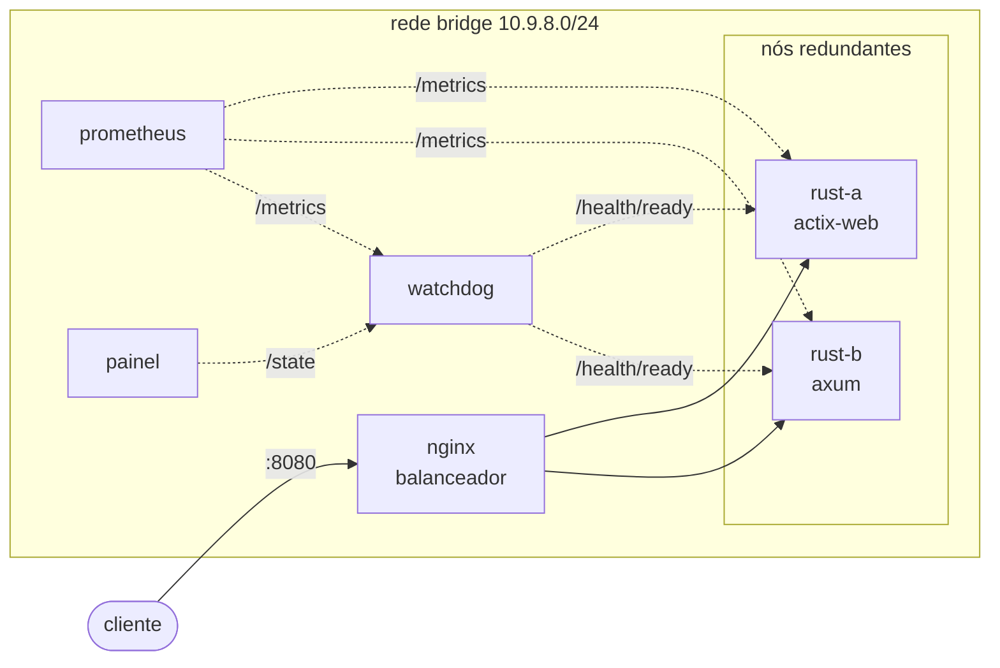

# Operação Sentinel

Cluster distribuído em Docker Compose para estudar **resiliência e observabilidade na prática**:
um balanceador Nginx na frente de dois nós Rust escritos com bibliotecas diferentes, um watchdog
que sonda os nós, Prometheus com regras de alerta testadas, um painel web e injeção de falhas de
rede com `tc netem`.

O objetivo não foi só subir o sistema, mas **provocar falhas uma de cada vez, prever o resultado,
medir e explicar** o que cada componente viu. Os resultados estão na seção
[O que os dados revelaram](#o-que-os-dados-revelaram).

## Sumário

- [Arquitetura](#arquitetura)
- [Decisões de Docker](#decisões-de-docker)
- [Conceitos de sistemas distribuídos aplicados](#conceitos-de-sistemas-distribuídos-aplicados)
- [Arquitetura dos nós Rust](#arquitetura-dos-nós-rust)
- [Observabilidade](#observabilidade)
- [Engenharia do caos](#engenharia-do-caos)
- [Experimentos](#experimentos)
- [O que os dados revelaram](#o-que-os-dados-revelaram)
- [Como rodar](#como-rodar)
- [Estrutura do repositório](#estrutura-do-repositório)
- [Limitações](#limitações)
- [Próximos passos](#próximos-passos)

## Arquitetura



Linha cheia: caminho do usuário. Tracejada: observação (a seta aponta para quem responde).

| Contêiner | Imagem / tecnologia | IP | Papel |
|---|---|---|---|
| `nginx` | `nginx:1.27-alpine` | .10 | entrada do usuário; round-robin, timeouts e 1 retry |
| `rust-a` | Rust + actix-web 4 | .11 | nó de aplicação A |
| `rust-b` | Rust + axum 0.7 | .12 | nó de aplicação B, mesmo contrato HTTP que o A |
| `watchdog` | Python (só biblioteca padrão) | .20 | sonda a prontidão dos nós e decide UP/DOWN |
| `prometheus` | `prom/prometheus:v2.53.0` | .30 | coleta métricas e avalia as regras de alerta |
| `painel` | Python + FastAPI | .50 | página com o estado dos nós segundo o watchdog |
| `toolbox` | `alpine:3.20` + curl, jq, tcpdump | .40 | operação dentro da rede |
| `trafego` | imagem da toolbox (perfil `trafego`) | .41 | usuários de fundo, 3 req/s |
| `chaos` | `alpine:3.20` + iproute2 (perfil `tools`) | sob demanda | injeta falhas de rede na saída de um contêiner |

**Contrato HTTP dos nós:** `/` responde "atendido por &lt;nó&gt;"; `/erro` devolve 500 de propósito;
`/health/live` diz se o processo está vivo; `/health/ready` diz se o nó pode receber tráfego;
`/metrics` expõe métricas no formato do Prometheus; `/admin/*` controla prontidão e atraso
artificial (só pela rede interna).

**Pontos únicos de falha.** Os dois nós Rust são redundantes entre si, mas o resto não é:

| Componente | É ponto único de falha de quê | Se cair |
|---|---|---|
| nginx | do serviço ao usuário | ninguém acessa; nenhum alerta (o Prometheus não coleta o Nginx) |
| watchdog | da observação dos nós | o painel e o alerta de nó DOWN ficam cegos; o usuário não sente |
| prometheus | dos alertas e do histórico | nenhum alerta dispara; watchdog e painel continuam |
| rede, Docker, host | de tudo | os dois nós caem juntos: as falhas não são independentes |

## Decisões de Docker

| Decisão | Por quê |
|---|---|
| Rede bridge própria com **IPs fixos** | o Nginx resolve os nomes dos nós uma única vez, na partida; se um nó voltasse com outro IP, continuaria recebendo tráfego no endereço antigo |
| **Só a porta 8080 é pública**; Prometheus e painel em `127.0.0.1` | `/admin`, `/metrics` e o watchdog são administrativos e não aparecem fora da rede; o Nginx devolve 404 para `/admin` e `/metrics` |
| `depends_on` com `service_healthy` | Nginx e watchdog só sobem depois que os dois nós passam no healthcheck |
| **Healthcheck de liveness** em todos os serviços | o Docker mostra `healthy` quando o processo responde; prontidão é outra pergunta, respondida pelo watchdog |
| Build Rust em **duas etapas** | compila em `rust:1.88-slim-bookworm` e executa em `debian:bookworm-slim`; o binário tem um modo `--healthcheck` porque a imagem final não tem `curl` |
| **Usuário sem privilégio** nos serviços | uid 10001 nos nós, 10002 no watchdog e no painel |
| **Versões fixas** em todas as imagens e dependências | build reproduzível; nada de `latest` |
| Logs `json-file` com rotação (3 × 10 MB) | o disco não enche durante os experimentos |
| **Perfis** `trafego` e `tools` | o gerador de tráfego e o chaos só sobem quando pedidos |
| **Sem** política de `restart` | de propósito: a ideia é observar a falha, não escondê-la |

## Conceitos de sistemas distribuídos aplicados

- **Balanceamento e redundância.** Round-robin entre dois nós. Se um nó falha na conexão, por
  timeout ou com 502/503, o Nginx refaz a requisição no outro (no máximo 2 tentativas, 4 s no total).
- **Detecção de falha passiva × ativa.** O Nginx de código aberto não sonda os nós: só descobre que
  um nó caiu quando uma requisição real falha (`max_fails=3` em `fail_timeout=10s`, depois tira o nó
  por 10 s). O watchdog faz a detecção ativa, sondando `/health/ready` a cada 5 s.
- **Liveness × readiness.** "O processo está vivo?" e "posso receber tráfego agora?" são perguntas
  diferentes. Um nó pode estar vivo e não pronto (aquecendo, ou com prontidão desligada). Lentidão
  deve tirar o nó do tráfego, não reiniciá-lo: por isso o atraso artificial afeta `/health/ready` e
  nunca `/health/live`.
- **Histerese.** O watchdog marca DOWN após 3 falhas seguidas e UP após 2 sucessos, para não oscilar
  a cada sondagem perdida. Ele também começa otimista (UP) antes da primeira sondagem.
- **Timeouts e retries.** Timeout curto descobre falhas rápido, mas retry demais amplifica a carga.
  Retry só é seguro para operações idempotentes (GET); um POST que cobra um cartão não pode ser
  repetido às cegas.
- **Falhas correlacionadas e diversidade.** Os dois nós implementam o mesmo contrato com bibliotecas
  diferentes (actix-web e axum). Isso protege contra um bug de uma biblioteca, não contra um bug no
  contrato, que existe nos dois (`/erro` dá 500 em ambos).
- **Quem vigia o vigia.** O monitor também é um ponto único de falha. Quando ele para, as métricas
  dele somem e o alerta que dependia delas fica sem dados, e um alerta sem dados nunca dispara.
- **Visão do nó × visão do usuário.** A latência medida dentro do nó não inclui rede, espera de
  conexão nem retry. O que o usuário vê só aparece no caminho completo (log do Nginx).

### Os tempos que explicam o comportamento

| Tempo | Onde | Efeito |
|---|---|---|
| 1 s | Nginx: conexão | um nó parado é descoberto em ~1 s, e a requisição é refeita no outro |
| 2 s | watchdog: timeout da sonda | mais rígido que o Nginx: acusa lentidão antes de o usuário sofrer retry |
| 3 s | Nginx: leitura da resposta | o usuário tolera até 3 s de lentidão sem retry |
| 4 s | Nginx: limite total; Prometheus: coleta | pior caso visto pelo usuário (1 s em A + 3 s em B) |

Consequência direta: com **2,5 s** de atraso em um nó, o Nginx aceita (abaixo de 3 s) e o watchdog
marca DOWN (acima de 2 s). Os dois discordam, e os dois estão certos.

## Arquitetura dos nós Rust

Cada nó é um microsserviço em um único arquivo, `src/main.rs`, com cerca de 400 linhas. Não há
arquitetura em camadas: é o padrão comum para serviços pequenos em actix-web e axum.

| Parte | Responsabilidade |
|---|---|
| Estado compartilhado | `struct AppState` com contadores atômicos, compartilhada por `Arc` (`web::Data` no actix, `Arc` no axum) |
| Utilitários | data em ISO 8601, log em uma linha, leitura de variáveis de ambiente |
| Middleware (`track`) | aplicado a toda requisição: `request_id`, contadores, histograma de latência e log |
| Handlers | uma função `async` por rota |
| Métricas (`metrics`) | texto no formato do Prometheus, montado diretamente no código |
| Healthcheck | modo `--healthcheck`, usado pelo Docker |
| `main` | lê a configuração, registra as rotas e sobe o servidor (actix com 2 workers; axum em um runtime tokio multi-thread) |

As métricas e a formatação de data são escritas à mão para não depender de crates extras
(`prometheus`, `chrono`), o que soma cerca de 100 linhas. O código dos dois nós é parecido de
propósito: é o mesmo contrato implementado em duas bibliotecas.

**Se o projeto crescer**, o caminho idiomático é dividir cada nó em módulos (`state.rs`,
`middleware.rs`, `handlers.rs`, `metrics.rs`), deixando no `main.rs` só a montagem, e mover o que não
depende da biblioteca HTTP (data, métricas, healthcheck) para um crate compartilhado em um
*workspace* Cargo. O arquivo único foi mantido para facilitar a comparação lado a lado.

## Observabilidade

**Três observadores, em paralelo.** O watchdog testa os nós de fora, pela rede. O Prometheus
coleta o que os nós e o watchdog relatam sobre si. O painel só repete o que o watchdog diz. Com o
Prometheus parado, o watchdog e o painel continuam funcionando.

**SLIs (o que é "estar bom"), definidos antes dos alertas:**

| SLI | Meta | Janela | Fonte |
|---|---|---|---|
| Disponibilidade vista pelo usuário | ≥ 99 % | 5 min | log do Nginx |
| Latência p95 vista pelo usuário | ≤ 0,5 s | 5 min | log do Nginx |
| Taxa de erro 5xx da aplicação | ≤ 2 % | 2 min | Prometheus |

**Regras de alerta** ([`prometheus/alerts.yml`](prometheus/alerts.yml)):

| Regra | Dispara quando | Por que assim |
|---|---|---|
| `NoDown` | o watchdog marca um nó DOWN por 15 s | 15 s = 3 sondagens de 5 s |
| `TaxaErro5xxAlta` | mais de 2 % de 5xx em 2 min, com tráfego mínimo, por 1 min | o piso de tráfego evita que 1 erro em 5 requisições vire 20 % |
| `LatenciaP95Alta` | p95 de um nó acima de 1 s por 30 s | avisa antes do watchdog (2 s) e do Nginx (3 s) |
| `NoNaoProntoRecebendoTrafego` | nó com `ready=0` recebendo tráfego por 15 s | o Nginx não consulta a prontidão |
| `MonitorParado` | o Prometheus não consegue coletar o watchdog por 15 s | sem o watchdog, as métricas dele somem e o `NoDown` fica sem dados |
| `MonitorSemSondar` | a última sondagem tem mais de 30 s | watchdog vivo, mas travado |

Toda regra foi escrita respondendo à pergunta "o que esta expressão retorna se a métrica sumir?".
As regras têm **testes unitários** com `promtool` ([`prometheus/alerts.test.yml`](prometheus/alerts.test.yml)):
um dos cenários prova que, com o watchdog parado, o `NoDown` desaparece e só o `MonitorParado` avisa.

## Engenharia do caos

Engenharia do caos é a prática de **injetar falhas de propósito, de forma controlada**, para
descobrir como um sistema distribuído se comporta antes que a falha aconteça sozinha. A ideia
ficou conhecida com o Chaos Monkey da Netflix, que desligava servidores em produção para garantir
que o serviço sobrevivesse a isso. Em vez de esperar o incidente, a equipe provoca o incidente,
mede o efeito e corrige o que não aguentou.

A disciplina segue um método parecido com o científico, e este projeto o aplica assim:

| Princípio | Como aparece aqui |
|---|---|
| **Definir o estado estável** | os SLIs (disponibilidade ≥ 99 %, p95 ≤ 0,5 s, erro ≤ 2 %) e uma linha de base medida antes de cada falha |
| **Formular uma hipótese** | previsão escrita antes de injetar: "se [evento], então [efeito], porque [mecanismo]" |
| **Simular eventos do mundo real** | processo parado, aplicação lenta, respostas 5xx, monitor fora do ar, atraso, perda e partição de rede, nó vivo mas não pronto |
| **Minimizar o raio de impacto** | uma falha por vez; as falhas de rede só atingem contêineres do projeto e são desfeitas com um comando |
| **Automatizar** | `scripts/experimento.sh` roda o ciclo completo: previsão, antes, injeção, durante, recuperação, depois |
| **Rodar em produção** | não se aplica: é um laboratório local, com tráfego sintético de 3 req/s |

**Como as falhas são injetadas.** Falhas de aplicação usam os endpoints `/admin` dos nós (atraso
artificial, prontidão) e `docker compose stop`. Falhas de rede usam o `tc netem` do kernel Linux:
o `scripts/chaos.sh` sobe um contêiner temporário com permissão `NET_ADMIN` dentro da rede do
contêiner alvo e configura, na **saída** da interface dele:

- uma fila `prio` com várias faixas, para separar o tráfego por destino;
- um `netem` com atraso, variação (*jitter*) e/ou perda de pacotes;
- filtros `u32` por IP de destino, quando se usa `--para`, para atingir só um caminho
  (por exemplo, só o tráfego de `rust-a` para o `nginx`);
- partição = 100 % de perda na saída do nó.

Como a falha atua só na saída, atrasar o `rust-a` em 800 ms atrasa as **respostas** dele. Cada
requisição tem duas travessias nesse sentido (a confirmação da conexão TCP e a resposta HTTP), por
isso o usuário espera cerca de 1,6 s, e não 0,8 s.

**Por que vale a pena.** Sem provocar as falhas, o sistema parecia correto: todos os alertas
estavam configurados e testados. Foram os experimentos que mostraram que dois tipos de falha
passavam sem nenhum alerta, que o Docker dizia `healthy` com o nó inalcançável e que o balanceador e
o monitor discordavam sobre o mesmo nó. Os detalhes estão em
[O que os dados revelaram](#o-que-os-dados-revelaram).

## Experimentos

Cada experimento seguiu o mesmo ciclo: **prever** no formato "se [evento], então [efeito], porque
[mecanismo]", injetar uma falha, observar, recuperar e comparar com a previsão. Condições:
tráfego de fundo de 3 req/s, uma falha por vez, volta ao normal antes do próximo.

| # | Falha provocada | Como | O que o usuário viu | Alerta (tempo desde a falha) |
|---|---|---|---|---|
| 1 | Parar um nó | `docker compose stop rust-a` | 100 % de 200; 16 requisições pagaram ~1 s | `NoDown` em 38 s |
| 2 | Nó lento (2,5 s na aplicação) | `admin.sh atraso rust-a 2500` | 100 % de 200, sem retry; p95 de 2,5 s | `NoDown` e `LatenciaP95Alta` em 43 s |
| 3 | Parar o monitor | `docker compose stop watchdog` | nada | só `MonitorParado`, em 28 s |
| 4 | Respostas de erro | 30 × `GET /erro` | 30 respostas 500 | **nenhum** |
| 5 | Atraso de rede de 800 ms | `chaos.sh atraso rust-a 800` | p95 de 1,6 s | **nenhum** |
| 6 | Nó vivo, mas não pronto | `admin.sh ready rust-a 0` | 100 % de 200, com 50 % ainda indo para o nó | `NoNaoProntoRecebendoTrafego` em 23 s, `NoDown` em 44 s |
| 7 | Nó isolado da rede | `chaos.sh particao rust-a` | 100 % de 200 via o outro nó | `NoDown` em 39 s |

Em todos, depois da recuperação: **0 reinícios** (`RestartCount=0`) e tráfego de volta dividido
entre os dois nós.

## O que os dados revelaram

1. **Disponibilidade de 100 % não significa que ninguém sofreu.** Com um nó parado, nenhum usuário
   viu erro, mas 16 esperaram ~1 s enquanto o Nginx descobria a falha errando com requisições reais.
   O p95 ficou em 0,002 s e escondeu esses casos.
2. **Lento não é parado.** Com 2,5 s de atraso, o balanceador considerou o nó bom e o monitor
   considerou o nó fora. Timeouts diferentes produzem visões diferentes do mesmo nó.
3. **Alerta sem dados nunca dispara.** Com o watchdog parado, o alerta de nó DOWN não tinha como
   disparar: as séries dele sumiram. Só uma regra sobre `up{job="watchdog"}`, que o próprio
   Prometheus gera, detectou o problema.
4. **O usuário recebeu 30 erros e o monitoramento não viu nenhum.** A rajada coube entre duas
   coletas, e o contador de erros 500 só passou a existir no primeiro erro; o `rate()` não conta o
   valor com que uma série nasce. O Prometheus mostrou 0 % de erro.
5. **Parecia saudável e não estava.** Com 800 ms de atraso na rede, o usuário esperou 1,6 s
   (2 travessias), enquanto o nó mediu 0,005 s, o watchdog ficou UP (1,6 s < 2 s), o Docker disse
   `healthy` e nenhum alerta disparou.
6. **Vivo não é pronto, e pronto não é alcançável.** Com `ready=0`, o Nginx continuou mandando
   tráfego ao nó (não consulta prontidão); o alerta criado para essa lacuna avisou 21 s antes do
   alerta de DOWN. Com o nó isolado da rede, o Docker continuou dizendo `healthy`, porque o
   healthcheck roda dentro do contêiner.

O ponto comum dos casos 4 e 5: **os alertas olhavam os nós, não o caminho do usuário**. Essa é a
principal melhoria apontada em [Próximos passos](#próximos-passos).

## Como rodar

**Pré-requisitos:** Docker com Compose v2, `bash`, `curl`, `awk`, `git` e cerca de 4 GB livres. A
primeira construção compila os dois nós Rust (alguns minutos).

| | Linux | macOS |
|---|---|---|
| Docker | Docker Engine (usuário no grupo `docker`) | Docker Desktop aberto |
| Falhas de rede (`chaos.sh`) | módulos `sch_netem`, `sch_prio`, `cls_u32` (Ubuntu: `sudo apt install linux-modules-extra-$(uname -r) && sudo modprobe sch_netem sch_prio cls_u32`) | funcionam dentro da VM do Docker Desktop |

### Subir

```bash
scripts/setup.sh --verificar   # confere pré-requisitos e portas
scripts/setup.sh               # build, sobe tudo e faz um teste de fumaça
scripts/status.sh              # estado geral: watchdog, nós, Prometheus, Nginx
```

- Serviço: <http://localhost:8080/>
- Painel: <http://localhost:8085/>
- Prometheus: <http://localhost:9090/>

### Testar

```bash
scripts/requests.sh 20                     # 20 requisições, alternando entre os nós
scripts/requests.sh fundo start            # tráfego de fundo (3 req/s)
scripts/status.sh --usuario --desde 2m     # o que o usuário viu: status, retries, p95
scripts/validar.sh                         # compose, nginx -t, configuração e regras do prometheus, sintaxe dos scripts
docker run --rm --entrypoint promtool -v "$PWD/prometheus:/p:ro" prom/prometheus:v2.53.0 \
  test rules /p/alerts.test.yml           # testes unitários das regras de alerta
```

### Provocar falhas

```bash
scripts/experimento.sh lista               # experimentos guiados 1 a 4
scripts/experimento.sh 1                   # pede a previsão, injeta, mede e recupera
scripts/admin.sh ready rust-a 0            # nó vivo, mas não pronto
scripts/admin.sh atraso rust-a 2500        # nó lento
scripts/chaos.sh atraso rust-a 800         # atraso de rede na saída do nó
scripts/chaos.sh particao rust-a           # nó isolado da rede
scripts/admin.sh pool drenar rust-a        # tira o nó do Nginx sem desligá-lo
```

> O `chaos.sh` só atua nos contêineres deste projeto, dentro da rede de cada um, e os efeitos somem
> com `scripts/chaos.sh limpar todos` ou ao recriar o contêiner. Use apenas em ambiente local.

### Recuperar e limpar

```bash
scripts/chaos.sh limpar todos
scripts/admin.sh ready rust-a 1
scripts/admin.sh atraso rust-a 0
scripts/admin.sh pool restaurar rust-a
scripts/requests.sh fundo stop
scripts/clean.sh                           # derruba o ambiente
scripts/remover-tudo.sh --simular          # mostra o que seria removido (contêineres, rede, imagens)
```

`scripts/evidence.sh <rotulo>` salva estado, logs e métricas em `evidencias/` antes de qualquer
reinício.

### Ajustes para macOS

O kit original foi feito para Linux. Para rodar no macOS foram necessários quatro ajustes pequenos,
sem mudar o comportamento no Linux:

| Arquivo | Problema | Ajuste |
|---|---|---|
| `docker-compose.yml` | dois serviços construindo a mesma imagem em paralelo falham no Docker Desktop | o serviço `trafego` usa a imagem que o `toolbox` constrói |
| `scripts/admin.sh` | `sed -i` só funciona no GNU | arquivo temporário e cópia por cima |
| `scripts/setup.sh` | `ss` não existe no macOS | usa `lsof` quando não há `ss` |
| `scripts/lib.sh` | com localidade pt-BR, o `awk` lia "2.503" como 2 | `LC_NUMERIC=C` |

## Estrutura do repositório

```
docker-compose.yml   topologia, rede, perfis
nginx/               proxy e balanceador
rust-a/  rust-b/     nós de aplicação (actix-web, axum)
watchdog/            monitor de prontidão
prometheus/          coleta, regras de alerta e testes das regras
painel/              página de estado
toolbox/             operação na rede interna; gerador de tráfego
chaos/               injeção de falhas de rede (tc netem)
scripts/             setup, status, requests, admin, chaos, evidence, experimento, validar, clean, remover-tudo
evidencias/          saídas geradas pelos scripts (não versionadas)
```

## Limitações

- **Uma máquina só:** um kernel, um relógio, um disco e um Docker para todos. Não há falhas
  independentes; dois nós não protegem contra a queda do host.
- **Rede simulada:** uma bridge virtual, com `netem` atuando só na saída de cada contêiner. Sem
  roteadores, filas de hardware ou partições parciais complexas.
- **Carga baixa** (3 req/s): não testa saturação nem amplificação real de retry.
- **Endpoints de administração** mudam estado com GET e não têm autenticação; a proteção vem só de
  não estarem expostos fora da rede.

## Próximos passos

1. **Medir o caminho do usuário:** coletar o Nginx (status e latência por nó) ou transformar o
   gerador de tráfego em teste sintético com métricas, e alertar sobre disponibilidade e p95 vistos
   pelo usuário. Resolve os falsos negativos dos experimentos 4 e 5.
2. **Contadores de erro criados em zero** na partida dos nós, para o `rate()` não subcontar rajadas.
3. **Readiness com efeito no balanceamento:** `/` devolver 503 quando o nó não está pronto, ou um
   balanceador com sondagem ativa.
4. **Segundo ponto de observação:** outro watchdog, por outro caminho de rede.
5. **Dividir os nós Rust em módulos**, adicionar testes de unidade e CI (clippy, shellcheck, ruff,
   promtool).
